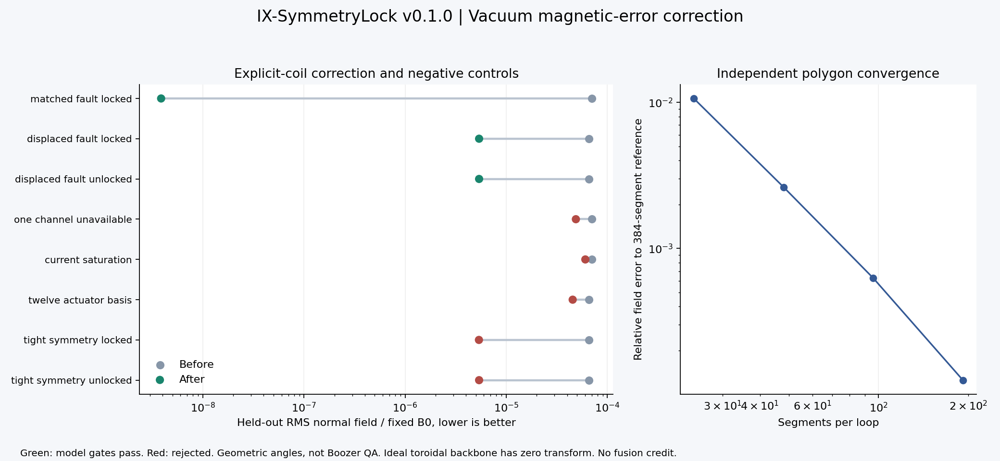

# IX-SymmetryLock

**Auditable symmetry-constrained magnetic-error correction research.**

Version 0.1.0 delivers explicit coil fields, bounded inverse correction, local controllability analysis, nonlinear symmetry gates, independent-grid validation and reproducible evidence. It develops the current IX-StellaratorForge research lineage without importing a named contact's patented or unpublished technology.

**Scientific stage: vacuum field correction proof of concept. Reactor promotion: false.**

## What actually runs

24 explicit local loop paths generate fields through an exact straight-segment Biot-Savart evaluator. An optimizer fits normal-field correction while respecting current bounds and, optionally, an inequality on the total field's geometric toroidal strength variation. It sees computed fields, not the injected inverse solution.

The campaign tests matched and shifted faults, unavailable channels, saturation, a smaller actuator basis and a tight symmetry demand. Every proposal is rechecked on a separate grid. Extra surface and polygon refinement and a seeded assumed-uncertainty screen are included. An independent replay audit reconstructs fields and gates from archived geometry and currents.

The primary toroidal field is **ideal analytic**, not a manufactured coil set. The symmetry metric uses **geometric angles**, not Boozer coordinates. The code does not rename that measurement quasisymmetry.

## Executed proof

| Result | Observed outcome |
|---|---|
| Shifted-fault correction, 10,585-point independent grid | **93.4219% lower normal-field RMS** |
| Last two refined normal RMS estimates | Approximately **0.00524% difference** |
| Matched in-span fault, primary held-out grid | 99.9945% lower RMS, recovery control |
| Unavailable channel, saturation, 12-actuator basis | Rejected for insufficient reduction |
| Tight geometric symmetry limit | Both variants rejected; locked solver exhausts its budget |
| Default locked versus unlocked displaced correction | Same result; no measured locking benefit at this tolerance |
| Exact first-order lock on every sampled strength residual | Zero safe actuator modes for this basis |
| Assumed geometry/current uncertainty | 12/12 model draws pass; not a reliability qualification |
| Test suite | **45 passing tests** |

Read [PROOF_OF_CONCEPT.md](PROOF_OF_CONCEPT.md) for complete results, injected inputs, thresholds and negative findings. [VALIDATION_REPORT.md](VALIDATION_REPORT.md) records the actual tested environment.



## Run locally

Python 3.11-3.13. Runtime dependencies are NumPy and SciPy. From this repository folder:

```bash
python -m pip install -e .
python -m unittest discover -s tests -v
python -m ix_symmetrylock poc --output results/local
python scripts/check_campaign.py results/local
python -m ix_symmetrylock verify results/local
python -m ix_symmetrylock audit results/local
```

For figures and lint:

```bash
python -m pip install -e ".[figures,dev]"
python -m ruff check src tests scripts
python -m ruff format --check src tests scripts
python scripts/plot_campaign.py results/local
```

[HANDOFF.md](HANDOFF.md) contains activation-free Windows PowerShell instructions, pinned validation dependencies, and a cautious new-repository GitHub push sequence. Remote CI status is unknown until the included workflow runs.

## The mathematical core

B_total = B_backbone + B_fault + sum I_k B_k.

J delta_I approximately -r is the inverse correction. SVD separates locally reachable residuals from components outside the available response space. Nullspace projection can protect specified first-order constraints. The bounded nonlinear solve and final total-field checks determine whether a proposed correction is accepted.

A full local column space does not overcome current saturation. A first-order projector does not guarantee nonlinear symmetry. More coils do not automatically improve a machine. The included negative cases preserve these distinctions.

[docs/MATHEMATICS.md](docs/MATHEMATICS.md) specifies the field formula, normalization, derivatives, nullspace, external Boozer coefficient arithmetic and information-gain assumptions.

## What this release does not establish

No finite-beta equilibrium, true QA field, useful rotational transform, alpha confinement, turbulence reduction, MHD stability, divertor performance, qualified magnets, neutron shielding, tritium breeding, ignition or net electricity has been demonstrated.

The ideal reference has zero rotational transform despite zero normal-field error. This negative control prevents a field-fitting result from being promoted into a fusion claim. Reactor promotion is permanently blocked in v0.1, even if an external JSON record labels every gate PASS.

There is no physical controller connection or hardware actuation. The current CSV contains proposals only. There are no empty solver adapters presented as working integrations, no invented vendor quotes and no dramatic superiority claim over StellaratorForge.

The complete [claims ledger](docs/CLAIMS_LEDGER.md) distinguishes implemented functions, conditional arithmetic, design-only work and results not run.

## Full BOM and source lineage

[BOM/FULL_BOM.csv](BOM/FULL_BOM.csv) and its JSON counterpart contain **96 research-inventory rows**: executable software/numerics, a proposed mapping bench and all reactor functional subsystems. Bench counts are proposals, not as-built hardware. Reactor quantities and prices are unresolved. This is not a procurement-ready reactor BOM.

[BOM/SOFTWARE_BOM.json](BOM/SOFTWARE_BOM.json) records the resolved runtime/figure dependency graph and preserved upstream notices. [BOM/README.md](BOM/README.md) explains quantity authority and engineering gaps.

[docs/LINEAGE_AND_IP.md](docs/LINEAGE_AND_IP.md) acknowledges StellaratorForge v0.10.0's existing inverse-design work and records what was retained or rejected from the nine supplied archives. Snapshot hashes are in `provenance/predecessors.json`. Source choices do not constitute patent clearance or a novelty claim.

## Repository map

- `src/ix_symmetrylock/`: geometry, fields, correction, diagnostics, accounting, tracing, audit and CLI.
- `tests/`: analytic physics, derivatives, negative controls, integration, integrity and claim boundaries.
- `configs/poc.json`: executable default parameters and declared authority.
- `results/poc/`: executed campaign, paths, currents, integrity manifest and plots.
- `BOM/`: full research inventory, resolved software graph and third-party notices.
- `docs/`: mathematics, claims, lineage, research protocol, evidence boundaries and continuation.
- `scripts/`: campaign checks, plotting and default inventory refresh.
- `.github/workflows/quality.yml`: Linux/Windows, Python 3.11-3.13 checks.

## License

Source-available, evaluation-only under [LICENSE](LICENSE), adapted from the author's StellaratorForge research license. Commercial, operational, construction and technology-transfer rights require a separate written agreement with Bryce Lovell. Third-party dependencies retain their own licenses.
